# Five additional speed improvements — approved implementation plan

12 October 2026, Pacific/Auckland. The user approved implementation and a Haiku 5.5 comparison. PR41 implements the ordered plan; this document retains the original architecture findings and proposed measurement design. Delivery and measured results are recorded separately. Independent audits remain required, and Haiku is a comparison arm until its results justify any default change.

## Architecture finding

Reviewed checkout: `5933a4927ddb92d29df6edc6a97429754e316843` of JoshuAI-888/leapedge-study. Production restored Google Gemini 3.8 Flash extraction/synthesis and OpenRouter Claude Sonnet 5 critique; keep these model families and independent audit stages. Google Gemini 3.1 Flash Lite translation and saved Jev settings remain unchanged.

The current execution path is:

```mermaid
flowchart LR
  S[Metadata and source] --> E[Parallel extraction]
  E --> C[Initial independent critique]
  C --> R[Parallel full-source recall]
  R --> A[Independent critique of additions]
  A --> P[Root publication]
  P --> B[Research brief synthesis]
  B --> F[Parallel faithful audit and coverage]
  F --> Q[Numeric gates and publication]
  Q --> L[Bottom line and browser refresh]
```

Every model call also performs transport description, token counting where supported, context/budget admission, reservation, response retention and settlement. Stages persist through the Postgres queue with lease fencing. This durability is valuable and remains.

Already implemented: bounded parallel extraction, recall concurrency 4, faithful-audit concurrency 4, paid-response replay and resume safety, and a two-second activity poll. An existing speculative-research option prefetches web planning/retrieval, not the transcript-only brief; enabling it would change scope and introduce web work, so it is not this optimisation.

Recorded native repeats: full briefs 140.848/85.015/181.026 seconds and model ledger costs $0.301590146/$0.177138656/$0.472971700 for T-Mobile/Planet Labs/Palantir. These are prior observations, not a new matched control. Median stage queue wait was 67ms; all 31 checkpoints across six parent/child rows totalled about 1.12 seconds. Database/queue replacement is therefore a low-priority speed hypothesis for these runs.

Twelve OpenRouter calls each traverse `describe()` and the uncached catalogue HTTP request. That conclusion follows code execution; actual catalogue latency has not been separately instrumented. Google description is already local. First root critic calls took 12.224/6.184/10.566 seconds. Palantir final faithful siblings took 43.868 and 11.378 seconds; T-Mobile siblings 37.323 and 2.663 seconds. Long synthesis also matters: Palantir research synthesis took 54.200 seconds. Scheduling changes cannot erase that generation floor.

## Ordered additional improvements

### 1. Cache and share transport preflight work

**Files:** `transport/openrouter.ts`, `transport/google-native.ts`, `pipeline.ts`, transport/reservation tests.

Add a 60-second validated catalogue cache and one shared in-flight lookup to the existing shared OpenRouter transport. Refresh on expiry and supported-parameter/model invalidation. Keep catalogue parsing, credential checks, worst eligible route rates and actual usage settlement. Freeze and record the descriptor/rates used for each reservation; cache provenance must be distinguishable from live lookup. Do not retain secrets in cache keys, logs or metrics.

Memoise exact token counts only for identical model/transport/content/media fingerprints. Do not replace Google counting with an unsafe bytes/4 estimate, use counts across changed media, or cache failed counts indefinitely. Instrument description, token counting, admission, provider call, retention and settlement separately. Persist model/descriptor identity and exact current request hashes for restart compatibility.

**Expected effect:** removes repeated metadata network waits without altering generated output or model tokens. Likely a modest latency gain; measure before claiming seconds saved. This is inference metadata caching, not cached analysis results.

**Acceptance:** one catalogue lookup for concurrent fresh-cache callers; expiry causes a refresh; parameter capabilities follow the retained descriptor; auth/catalogue failures behave correctly; rates and budgets remain conservative; changed request/media produces a fresh count. Same malformed response and unknown outcome protections apply.

### 2. Overlap initial critique and recall discovery safely

**Files:** `pipeline.ts`, `source-recall.ts`, `bounded-parallel.ts`, model-call admission and concurrency tests.

Start initial cross-family critique and recall discovery from separate immutable snapshots after extraction. Tentative extraction proposals are explicitly pending, not accepted coverage. Recall must retain material source propositions even if they duplicate a tentative proposal: rejection by the initial critic cannot leave that proposition marked covered. Reconcile discovery with actual initial verdicts and the final accepted inventory at a barrier. Only structurally valid additions enter the existing independent critique. Every publication still waits for its own audit and deterministic checks.

Avoid two branches mutating the same `run.output`. Return branch results and merge in deterministic ID order. Preserve source-range IDs, model-call fingerprints and one owner of each ledger/reservation. Use a shared bounded admission limit across the overlapping branches; do not silently double all pools. Drain started paid calls after a sibling failure, retain their outcomes, stop further admission for fatal account failures, and resume unfinished work without duplicate charges. Introduce a versioned run plan and persist it before paid work; old runs resume under their old plan.

**Expected effect:** initial critic wall time can overlap recall, rather than add to it. Previous first critic calls give an ideal overlap ceiling around 6–12 seconds in these samples, not a promised gain. Reconciliation, quota contention or necessary recovery can reduce it. Root multi-window critique is currently sequential; parallelise independent windows under the same admission module when more than one has pending work. Do not misclassify the two `critique` calls in the repeats as independent windows: one follows recall and depends on its additions.

**Acceptance:** a rejected tentative claim is not lost from recall coverage; identical source accounting and independent audit targets survive; completion order does not alter IDs or accepted content; kill/resume/lease-expiry, one fatal sibling and unknown provider outcomes do not cause duplicate billing. Verify concurrency on real Postgres, since PGlite cannot prove locking.

### 3. Balance audit work by evidence weight

**Files:** `faithful-audit.ts`, `bounded-research-audit.ts`, `research-pipeline.ts`, audit/planner tests.

Current faithful chunks use a fixed 12-sentence count. Evidence coverage ownership goes to the first citing chunk, and evidence cited only by Jev-accepted sentences can collect in one coverage-only chunk. Plan deterministic batches by estimated quote bytes/tokens, financial-fact/condition count and coverage workload. Preserve all required original evidence and all citing sentences for each owned coverage item. Each sentence receives exactly one definitive audit target and each original evidence item receives one coverage target; no quote truncation or acceptance by majority vote.

Keep concurrency bounded at four initially. If the immutable batch plan predicts several very uneven batches, split the heavy independent work rather than raising the global limit. In the separate bounded-research-audit path, verdict jobs may run in a bounded parallel wave; coverage begins only after the application has accepted/rejected the full verdict wave. Preserve per-job retained paid responses and checkpoint durability. This alternate path is not the faithful baseline, so its improvement must not be credited to the three faithful runs unless exercised.

**Expected effect:** shorter slowest-batch time. Existing 44s versus 11s siblings motivate this; reasoned token generation and evidence complexity may still dominate. More batches can cost more due to duplicated context, so choose the plan by measured cost and fidelity, not sentence count alone.

**Acceptance:** exact target and provenance coverage; no missing/foreign/duplicate IDs accepted; failed batches withheld; cross-sentence contradictions and attribution preserved; coverage is recomputed against actually accepted clauses. Benchmark weighted plans against the old plan on identical source/draft data. Missing numeric grammar and actor/action fixes from the previous plan are prerequisites, not sacrificed for speed.

### 4. Deliver independently checked findings before the complete brief

**Files:** `pipeline.ts`, `runner.ts`, run detail/activity projections, `analyst-view.ts`, `Analysis.tsx`, `workspace.tsx`, UI and projection tests.

Persist a versioned provisional reading projection after an independently audited batch passes the deterministic gates. Render only the exact accepted clauses with source timestamps, creator attribution, qualifiers and uncertainty. Label this view "Checked findings — full-source coverage still in progress"; never present it as a completed brief or show inferred completeness. Only display short summary wording that has its own audit or is a deterministic projection of an accepted assertion. Omit unaudited root context from the reviewed surface.

Add a findings revision to the narrow activity response and refresh the active result on that revision. Current Analysis detail refresh depends on stage/status and broader workspace snapshots, so a new result inside a long audit stage can be missed until the stage changes. Keep the existing poll initially; avoid adding a persistent websocket/streaming worker just for a two-second notification delay. Do not wake a worker from page visits.

Combine this with the previous heading/coverage fixes: company and qualified assessment, 30-second overview, business thesis, valuation and assumptions, countercase, next checks, then evidence. Stable final publication replaces the partial view without losing a user's reading position or selected evidence.

**Expected effect:** improves time to the first useful audited finding; usually little reduction in full-pipeline completion. Measure and report both separately. It is the clearest usability advantage for a time-poor analyst, conditional on preserving the distinction between checked claims and incomplete coverage.

**Acceptance:** zero pending or rejected atoms in a reviewed view, including copy/export; stale poll responses cannot downgrade a newer revision; source citations and all material conditions retained; partial/failed/resumed states honest; desktop and 375px browser verification. A provisional bullish point must not imply that countercase search has finished.

### 5. Route the same critic model by speed within existing constraints

**Files:** `transport/openrouter.ts`, transport settings and provider UI, reservation/fingerprint/schema tests.

Current OpenRouter body requires parameters and disables fallbacks, but does not select throughput or latency sorting. Add a versioned optional route preference for the same Claude model: compare default routing with throughput sorting for larger audits and latency sorting for small verdict jobs. Preserve `require_parameters:true`, disabled fallbacks, current eligible-provider/data policies, exact model family and a price ceiling. Record the actual serving provider, returned usage, routing policy and wall time. Include the route policy in new-run request identities; never replay an earlier paid response as evidence of a newly selected route.

Prefer actual measured complete-response time, not only first-token latency. Enable a faster policy only if this model has multiple eligible endpoints and repeated samples show a useful gain within the price ceiling, without schema/fidelity regressions. If only one endpoint meets the constraints, report no opportunity and preserve the default. Do not hedge paid calls to two endpoints: the loser may be billable and uncertainty would complicate the ledger.

**Documentation:** https://openrouter.ai/docs/guides/routing/provider-selection supports sorting by price/throughput/latency, required parameters, provider restrictions and maximum prices. These are routing preferences, not guarantees of speed or identical stochastic output.

**Expected effect:** uncertain until tested; could improve audit tail latency or cost more. Implement the controlled option last, and retain it as opt-in if the evidence does not justify a default change. Keep Google native as the default extraction provider.

**Acceptance:** supported request shape, unsupported required parameters excluded, same-model/family audit invariants, eligible-policy enforcement, conservative reservations, route fingerprint distinctions, unknown outcomes retained without blind retries, and measured cost/fidelity review before promotion.

## Integrate with the earlier plan

The five ideas add transport preflight reuse, safe stage overlap, workload balancing, audited incremental delivery and same-model endpoint routing to the existing evidence/number/atomic-publication/token/layout checklist. They do not replace those quality fixes.

Implementation sequence after approval:

1. Freeze the baseline and add the previous plan's evidence/actor/action/numeric/display regressions. Implement its accepted-proposition and atomic-publication prerequisites first, including one bounded source-only repair and review of every changed clause. Correct stale specification text that still calls Cheaper Inference the default.
2. Deliver additional improvements 1 → 2 → 3 → 4 → 5 in that order, in reviewable commits/PRs. Fold the previous token-dictionary/local-recall work into step 2, accepted-graph reuse into steps 3–4, and heading/coverage rendering into step 4. Keep independent root/addition/final audits and the current Jev routing rules; do not broaden pre-screen acceptance to make timing look better.
3. Complete the original plan's remaining bounded validation and rollout checklist, then the measured repeats below. Performance changes go behind frozen, versioned run settings so rollback and matched controls remain possible. All new paid work uses normal reservations and settlement; no blanket pipeline reset, model change, budget increase, DB migration or global monitoring change is implied.

For each integration milestone use the repo's required two full suites, typecheck, production build and offline advisory diagnostic; targeted contract tests first. Real Postgres is required for concurrency changes and browser verification for user-facing changes. An advisory diagnostic must remain labelled advisory. Update the delivery ledger in the same commit and retain the distinction between local completion, PR merge and production release.

## Matched video benchmark after implementation

Use the exact videos: T-Mobile `_mEvVWGfmjU`, Planet Labs `Mepjkm_0ns4`, Palantir `fSx-Ho8mi18`.

Run six fresh analyses: a baseline and candidate for each video, both using the retained identical source and original provider/model settings. Freeze prompt, pipeline, source hash, Jev and budgets except the explicitly versioned experimental changes. Alternate baseline/candidate order across videos and keep concurrent-video load identical; new model requests on both arms, never application result replay. Use the original implementation under flags as the contemporaneous control; yesterday's 141/85/181s remain historical context, not causal evidence. If a feature cannot be safely disabled, use an isolated control deployment rather than claiming an unmatched result.

Count metadata/preflight cache hits separately from analysis replay and upstream prompt caching. Source retrieval and cache warming are reported separately; T-Mobile now has captions, so both new arms must use the same caption source. Capture every output, draft, rejection, repair, accepted atom, coverage record, request/response hash, serving provider, token count and settled/unknown cost. Plan the six-run model-spend ceiling at US$5, subject to stricter existing per-video/workspace limits; no budget increase or extra LeapEdge credit is required. Do not run a paid parameter grid for route selection; use the final bounded candidate comparison first, and keep an unproven routing preference opt-in.

Report separately: source acquisition; model description/counting; initial extraction; first checked finding; complete independently audited brief; browser-visible time; tokens and recorded model cost. Unknown/open holds are reported, never treated as zero. Do not claim full all-in cost without source-service and infrastructure attribution.

Quality: review fixed material units against exact source quotes; unsupported/reconstructed numbers, actor/action strengthening, missing conditions, opposing cases, ownership and next tests. Measure content actually displayed and exported, not just retained rows. Preserve the observed Planet Labs watch/entry distinction, T-Mobile conditional rerating, Palantir count/EPS ambiguity and supported cents/shared-billion cases. Reject a rollout that speeds up by deleting material qualifiers or re-exposing rejected context.

Usability: verify hierarchy, initial viewport, mobile layout, stable updates, source access and copied notes. Record an analyst reading-task walkthrough and its evidence, but do not claim an actual five-person comprehension study without participants. Target finding stance, economic reason, key assumption, countercase and next check within 30 seconds; measure missing information explicitly.

Reuse prior fresh LeapEdge captures, whose observed readiness bounds were roughly 35–50/38–61/10–48 seconds. LeapEdge exposes `critique.v1`, and its audit depth/cache scope are unknown; do not label it audit-free or present a cached rerun as a fresh competitor control. Three matched pairs are an initial pilot, not statistical p95 or population quality evidence. Proposed full-reviewed latency target remains 60–90 seconds for typical captioned videos, with no fidelity regression; there is no guarantee that these changes beat LeapEdge on every video.

## Source anchors

- `src/server/youtube-intelligence/pipeline.ts:183`: token counting; `:288`: modelCall; `:1511`: initial critique; `:1601`: sequential root critique windows; `:1793`: recall after critique; `:1851`: recall pool of four.
- `src/server/youtube-intelligence/transport/openrouter.ts:150`: uncached catalogue lookup; `:182`: request body and provider preferences.
- `src/server/youtube-intelligence/transport/index.ts:219`: shared transport instances.
- `src/server/youtube-intelligence/faithful-audit.ts:39`: fixed sentence chunks/evidence ownership; `:71`: parallel faithful audit and pre-screen routing.
- `src/server/youtube-intelligence/bounded-research-audit.ts:23`: separate one-paid-job-per-step state machine and verdict/coverage dependencies.
- `src/server/youtube-intelligence/research-pipeline.ts:240`: request trace/invoke; `:395`: brief generation; `:413`: preflight/final audit.
- `src/features/youtube-intelligence/ui/pages/Analysis.tsx:123`: detail refetch; `:170`: dependencies.
- `src/features/youtube-intelligence/ui/workspace.tsx:167`: two-second activity polling.
- `architecture-evidence.json`: locally calculated metrics from the retained native-repeat captures; not new live timing.

Approval requested by the user's instruction before implementation. This proposal intentionally leaves application and live-state changes pending.
