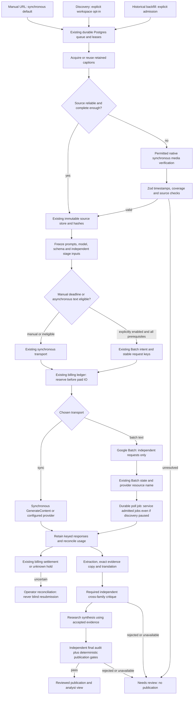

# Workload recommendation and promotion plan

**No production promotion from this experiment.** Keep the current manual synchronous provider mix and publication safeguards. Extend existing Batch support toward **opt-in frozen-text backfills**, after the identified operations/pricing/quality blockers. Do not adopt Batch video transcription based on the rejected request or the generic multimodal statement. Do not change customer-facing defaults, deploy, or activate monitoring.

| Workload | Decision | Reason |
|---|---|---|
| Manual submitted research | Keep synchronous | Raw text14s versus Batch first-observed149–259s; dependent stages add delays; no complete reviewed comparison. Preserve current minutes-scale UX. |
| Reliable existing captions | Reuse | Exact retained source/hash available; no media/caption purchase needed. Caption quality remains unverified speech, not a reason to retranscribe everything. |
| Newly discovered channel videos | Defer automatic Batch promotion | Explicit opt-in plus operational servicing, compatible models, source readiness, budgets and independent critic required. Current workspace channel mode default is not evidence of compatibility. |
| Historical frozen transcripts, native Google stages | Conditional next experiment | Three same-input text extractions succeeded and cost less at the stage boundary. Source-fidelity issues, cache confounding and missing reviewed all-in economics block promotion. |
| Missing/questionable captions | Current permitted synchronous verification or review | Three short direct URL intervals were accessible; no complete-video accuracy evidence. Batch URL request rejected and cause lost. No unsupported download workaround. |
| Direct YouTube Batch transcription / grouped video | No-go for rollout; compatibility unresolved | Exact small request rejected 400. No successful workload proof, quality/timing evidence or permitted uploaded-media alternative tested. |
| Independent critique / final publication | Preserve required cross-family checks | Expired OpenRouter key blocks live completion; routing Gemini as its own independent critic would invalidate the test. |
| Grouped text requests / JSONL | Design next, then isolated verification | Pinned SDK grouping works offline. Existing one-job-per-item orchestration is reliable but does not prove grouped ownership, billing, partial-result or throughput behavior. |

## Comparison scorecard

Scores use evidence categories instead of invented accuracy percentages: **V** verified at the stated boundary, **P** partial/projection, **B** blocked/no-go, **U** unmeasured. No category implies an independent speech-quality pass.

| Criterion | Sync native Google | Existing configured mixed pipeline | Gemini Batch | Proposed hybrid |
|---|---|---|---|---|
| Source accuracy | U;3 intervals structurally valid | U; historical caption fidelity issues remain | U for text interpretation; video B | U; reuse frozen source, verify questionable media |
| Timestamp evidence | P; offsets/bounds, no listened anchors | P; coverage/agreement gates | B for exact video test; text preserves pointers | P; keep current timestamp/trust gates |
| Investment fidelity | B for unaudited guidance reconstruction | P; safeguards exist, historical errors still documented | B for unaudited guidance reconstruction | U until all stages independently audited |
| Latency | V; raw extraction12.5–15.2s | P; historical full briefs85–181s | V; raw text first-observed149–259s | P; manual sync, background deadlines |
| Throughput | U; no saturation test | P; real queue/concurrency checks | P;3 jobs completed, no grouping/load test | P; prerequisite/routing unit tests only |
| Total cost | U all-in; stage costs measured | U all-in; historical 49-call breakdown | U all-in; observed extraction reduction50–67% | P; root-only ceiling20.12% of historical model spend |
| Reliability | P; current transport/tests | P; complete offline regression suite | P; submission/result/error tests and3 completed jobs | U in production; proposed only |
| Recoverability | V at retained-call/lease boundary | V local real Postgres, mocked model | V local crash/dedupe; uncertain bills need operator | P; reuse same queue/ledger, no new state machine |
| Operational complexity | P; existing serving path | P; several providers/gates | B for unattended rollout until cron/monitoring coupling fixed | P; explicit admission/servicing ownership needed |
| Future scale | U beyond current cohort | P; historical cost/queue model | P;100-job/token limits constrain one-request jobs | P; grouping/backoff potential, unverified |

## Recommended architecture (proposal, not deployed)

Each dependent stage returns to the existing queue/checkpoint path before the next input is constructed. A single provider batch never owns an extraction→translation→critique→synthesis graph. Retained text stage grouping is a future extension of existing intent/key mapping, not a second billing ledger or orchestrator.

## Minimal roadmap

Effort is an engineering estimate, not a delivery promise.

| Order | Change | Effort / dependencies | Regression risks / acceptance |
|---|---|---|---|
|1|Review and merge bounded safety repairs from PR46: incomplete usage/unknown replay, malformed output, sanitized errors and admission validation|0.5–1 day; repository maintainer review|Old completed responses must replay; unknown bills cannot be zeroed, retried or generically released. No migration/default change.|
|2|Restore critic credential through existing secret-management process; date/model/modality/context-tier native pricing and reservation bounds; invoice reconciliation|1–2 days; provider operator|No secret in artifacts. Pro long-context, cached reads/storage and Jan2027 expiry need fixtures before any Pro workload. Preserve Sonnet family independence.|
|3|Decouple servicing already-admitted batch/poll jobs from discovery/monitoring opt-in; persist provider-state timestamps and versioned manifest metadata; bounded backoff/indexed lookups|1–2 days; reviewed queue/cron change and verified hosted flags|Pausing discovery must not strand existing holds. Test real Postgres overlapping drains, stale owners, temporary reads, lost resource names, expiry/cancellation and manual priority. No always-on second orchestrator.|
|4|Add grouped same-model text requests only if overhead measurements justify it|2–4 days; durable per-item manifest/ownership in current batch abstraction|Atomic per-item reservations, one uncertain group submission blocks retries, exact key cardinality, reordered/mixed/missing/duplicate results, independent settlement and output-file retention. Never group stages with unresolved dependencies.|
|5|Repeat3-case complete reviewed workflow, then8–12 only after clean feasibility|1–3 days plus provider turnaround and review; valid critic, licensed evidence and remaining budget|Same frozen sources/prompts/models/schemas, counterbalanced order/cache accounting. Add long, captionless, Chinese/code-switching, noisy/rapid speech and exact financial semantics. Use independent listened references for accuracy; source agreement otherwise.|
|6|Propose staged opt-in production rollout with explicit owner, monitored budgets/deadlines and rollback|1–2 days after evidence review; separate authorization|Require all promotion gates below. No deployment is authorized by this investigation.|

## Promotion evidence required

1. Exact production request/API/SDK/model workload compatibility, including media only if separately proven. A successful text job cannot promote video.
2. Reviewed samples show no material source-fidelity regression and no newly unsupported investment claims; original-language numerical, attribution, negation and conditional regressions pass. Independent listened references are needed for any WER/CER/timestamp accuracy claim; an arbitrary50-case legacy requirement is not reinstated.
3. Existing Zod, deterministic, independent-family, repair and publication gates remain enforced. Manual UX stays synchronous and within the agreed minutes objective on a full reviewed flow.
4. Submission/hold/settlement invariants pass real isolated Postgres and provider reconciliation. Failed and uncertain work counts in cost; model usage-derived estimates are distinguished from invoice-confirmed charges.
5. At least15% **measured all-in** saving on eligible async videos, including caption credits, independent audits, failed/held calls, polling and hosting/DB. The historical20.12% root-only model ceiling gives limited overhead headroom; do not lower15% based on advertised tariffs. A different threshold needs explicit evidence of service value versus complexity and a separate decision.
6. Operator owns queue age, callback/poll health, partial/unknown outcomes, result retention before six-week deletion, pricing expiry and budget alarms. No monitoring was activated here. Deployment flags and access restrictions must be checked before rollout.

Rollback: stop **new** asynchronous admission using existing configuration; keep servicing known provider jobs, retrieving paid results and retaining unknown holds. Route newly admitted manual/text work to immediate only where independently budgeted; never automatically duplicate an in-flight Batch request synchronously. Revert code if required without deleting paid response/intent/ledger records; no schema migration is needed for this PR. Cancellation is best effort and does not prove zero spend. Review pending/unknown item identities with the existing ledger and operator. Default/secret changes and any future deployment are separate reviewed operations.
